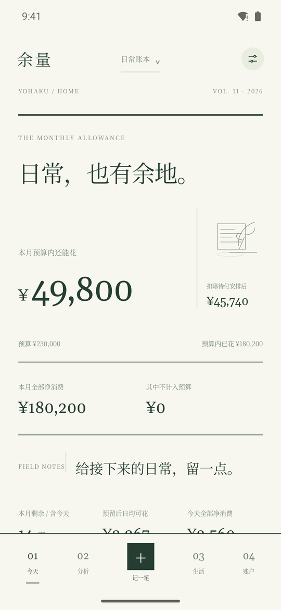
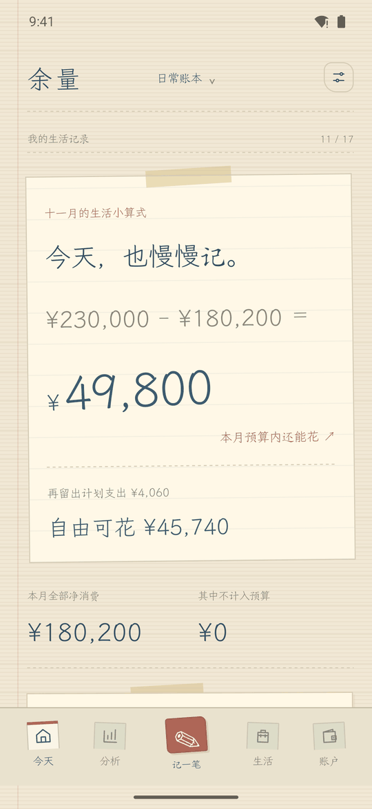
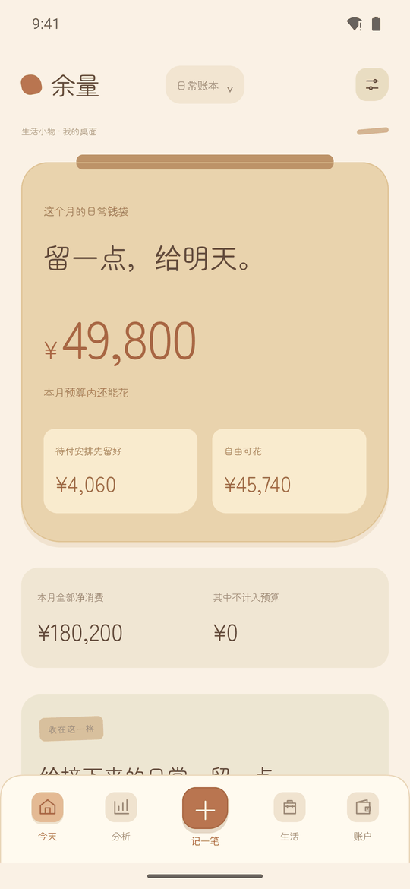
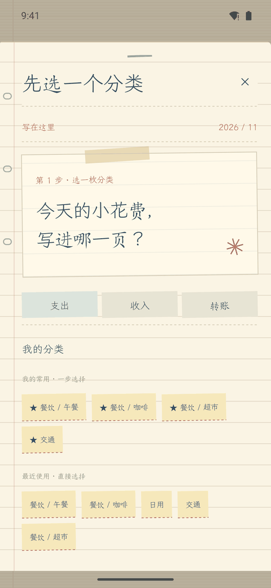
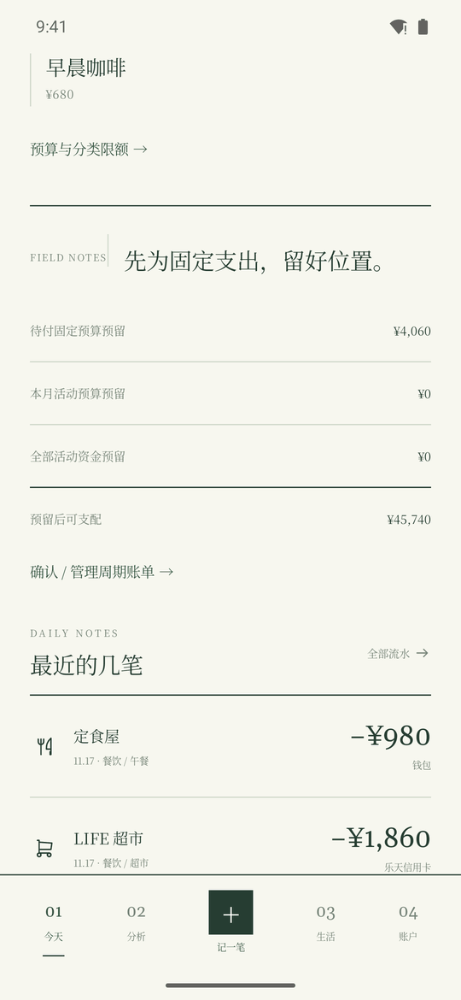
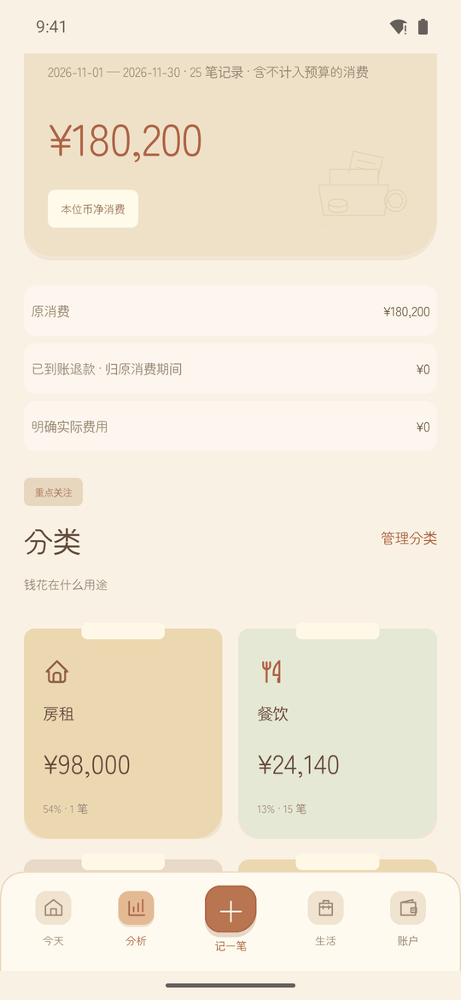
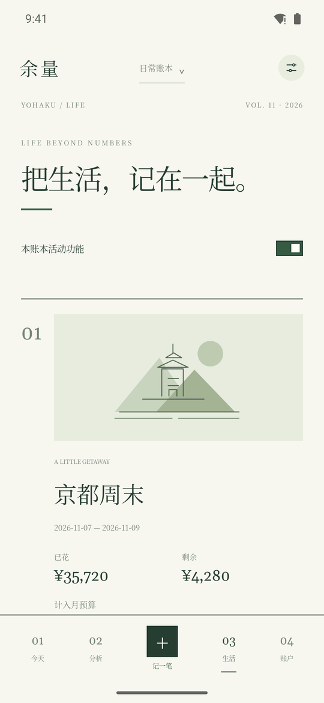
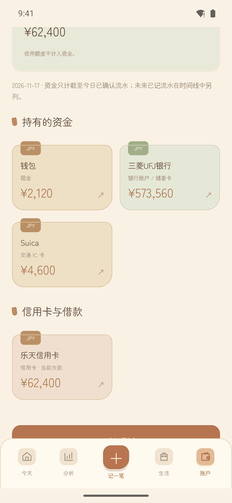
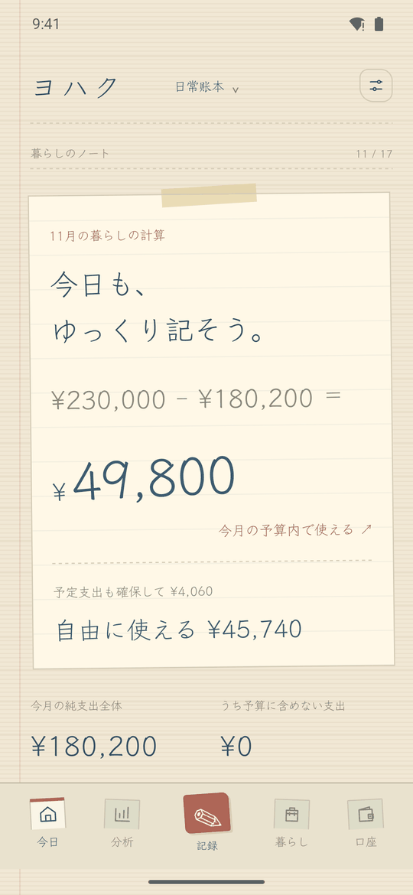

# 余量 Yohaku

> 日常，也有余地。

余量是一款本地优先的 Android 记账应用，使用原生 Kotlin / Jetpack Compose 开发。它不只记录钱花到了哪里，还会结合月预算、固定支出、信用卡还款和预计收入，算出这个月还能花多少，以及接下来的资金是否够用。

账本只保存在手机上，不需要注册账号，也没有云同步。界面支持中文和日文，提供三套完全独立的视觉主题，可按账本分别选择。

<table>
  <tr>
    <th>现代生活杂志</th>
    <th>纸质手账</th>
    <th>日常小物</th>
  </tr>
  <tr>
    <td></td>
    <td></td>
    <td></td>
  </tr>
  <tr>
    <td>松绿与留白，编辑式排版</td>
    <td>纸页与墨蓝，手写批注感</td>
    <td>陶土橙与黄油色，口袋和小票</td>
  </tr>
</table>

三套主题不是换一套配色：版式、字体、插画、按钮、弹层、日期选择和空状态都分别设计。切换主题后，整个应用的观感都会改变。

## 功能

**记账**

- 先选分类、再填金额；金额可以直接输入 `＋−×÷()` 算式；常用分类、记账模板和桌面小组件都能一步开始记账
- 收入、支出、转账、还款、借款、退款（支持全额、部分和分次退款）
- 多币种：原币、账户币和本位币分开记录，可参考 Frankfurter 汇率；在途资金和手续费单独记录
- 附件与小票图片；应用内用相机扫描小票，在设备端完成裁边和矫正
- 商户目录与地点：新建今天的支出时会做一次前台定位，自动带出附近的常去商户

**预算与计划**

- 月预算、两级分类预算，可将单笔支出设为不计入预算
- 周期账单：先为固定支出预留额度，到期时预览后一键确认
- 活动（旅行、搬家等）：可跨月记录，有独立预算，支持同行朋友分摊和请客
- 预计收入与逐日资金预测，提前提示扣款账户可能出现的缺口

**账户与金融**

- 现金、银行、交通 IC、信用卡、贷款账户
- 信用卡账单、一次付、分期、リボ（循环还款）、额度及共享额度；规则由用户填写，不内置任何机构的预设
- 银行与信用卡流水核对，可补记漏掉的记录

**分析**

- 分类、商户、趋势、活动、同期对比等模块，可自选和排序
- 全部流水支持列表和日历两种视图，可搜索商户、备注、金额和小票商品名

**数据**

- 每本账本相互独立，可归档、回收和恢复
- 手动完整备份和恢复（`.yohaku` 文件），可从其他记账软件导入 CSV
- 云端分析台交接：由用户主动发起，把小票或银行资料交给自己部署的分析台，返回的结果必须在本机预览并确认后才会写入账本

## 截图

<table>
  <tr>
    <td align="center"><br>记一笔：先选分类</td>
    <td align="center"><br>固定支出预留与最近几笔</td>
    <td align="center"><br>分析：按分类</td>
  </tr>
  <tr>
    <td align="center"><br>生活：活动与活动预算</td>
    <td align="center"><br>账户：资金与欠款</td>
    <td align="center"><br>日文界面</td>
  </tr>
</table>

截图使用虚构的演示账本，在 1080×2340、density 450 的 Android 模拟器上拍摄（对应 Galaxy S24 Ultra 的默认分辨率）。

## 安装

需要 Android 10 及以上版本。已构建的安装包在 [`android/artifacts/`](android/artifacts/)：

| 安装包 | 包名 | 说明 |
| --- | --- | --- |
| [yohaku-release-0.5.0.apk](android/artifacts/yohaku-release-0.5.0.apk) | `com.yohaku.expensetracker` | 正式版，固定签名 |
| [yohaku-dev-0.5.0.apk](android/artifacts/yohaku-dev-0.5.0.apk) | `com.yohaku.expensetracker.dev` | 开发版，可与正式版同时安装 |

```sh
adb install -r android/artifacts/yohaku-release-0.5.0.apk
```

两个包互不共享数据。卸载或清除存储会删除账本，请先在 设置 → 数据 → 备份与恢复 中导出备份。签名、升级和校验方法见 [android/RELEASE.md](android/RELEASE.md)。

## 从源码构建

环境要求：JDK 17、Android SDK（compileSdk 37），SDK 路径写在 `android/local.properties` 或 `ANDROID_HOME` 中。

```sh
cd android
./gradlew :app:assembleDebug --max-workers=2
./gradlew :app:testDebugUnitTest --max-workers=2
```

Gradle 任务请逐条串行执行，不要并行，否则可能占满内存。正式包需要外部签名密钥，配置方法见 [RELEASE.md](android/RELEASE.md)。仪器测试分层、截图验证和自定义参数见 [android/README.md](android/README.md#构建与验证)。

技术栈：Kotlin 2.3、Jetpack Compose（Material 3）、Room、DataStore、WorkManager、kotlinx.serialization、CameraX、ONNX Runtime + OpenCV（小票扫描）、MapLibre（地图选点）。

## 仓库结构

```text
android/            Android 应用源码（Gradle 工程）
  app/              应用模块：data / domain / ui / platform / receipt（小票扫描）
  artifacts/        已发布的 APK 与 SHA-256
  tools/            设计稿对照截图、字体处理与本地模拟服务脚本
design/             三套主题的 HTML 高保真设计稿与字体
docs/               产品规格、实现规格、开发计划与文件协议
  formats/          云端交接 JSON 格式（schema 与示例）
  plans/            各阶段开发计划与验收记录
  screenshots/      本 README 使用的截图
```

## 文档

| 文档 | 内容 |
| --- | --- |
| [android/README.md](android/README.md) | 应用实现说明、各功能的变更记录、测试方法 |
| [android/RELEASE.md](android/RELEASE.md) | 签名、安装与升级 |
| [docs/product-design.md](docs/product-design.md) | 产品与设计规格 |
| [docs/implementation-spec.md](docs/implementation-spec.md) | 实现规格（数据模型、统计口径、备份格式等） |
| [docs/formats/README.md](docs/formats/README.md) | 流水、小票和云端办理的文件协议 |
| [design/README.md](design/README.md) | 设计稿入口与本地预览方法 |
| [docs/haptics.md](docs/haptics.md) | 三套主题的触感设计 |
| [docs/plans/](docs/plans/) | 开发计划与各阶段记录 |

## 许可

本项目为非商业个人项目。小票扫描所用模型和第三方库的许可与来源，见 [android/README.md](android/README.md#第三方许可与模型来源)。
